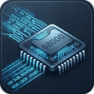
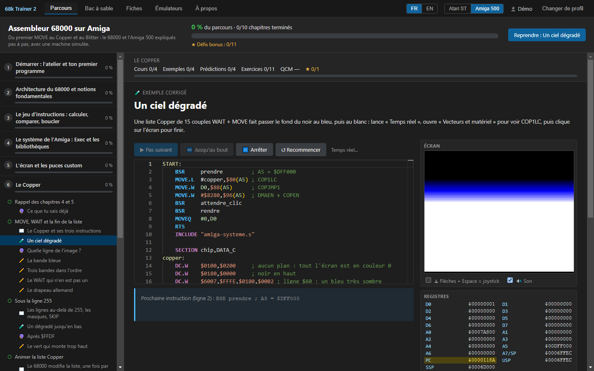
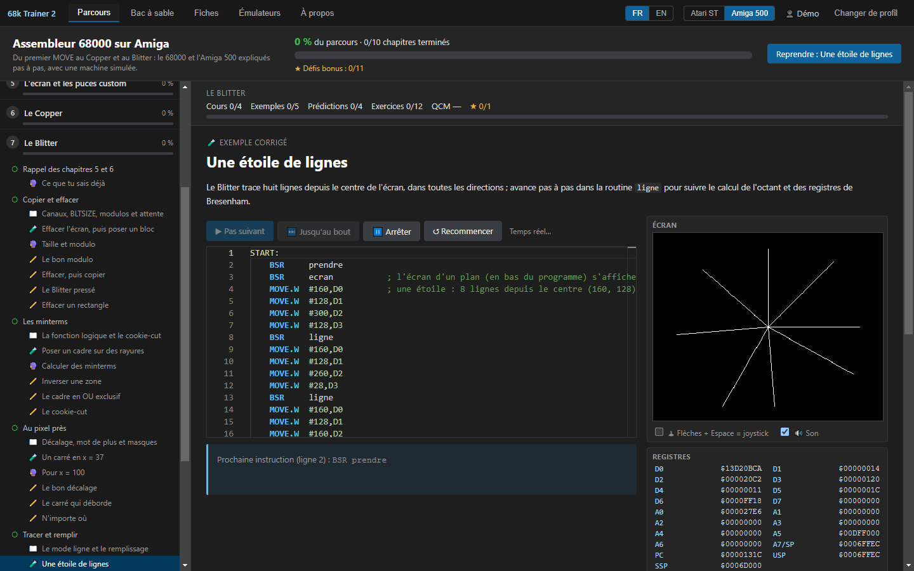
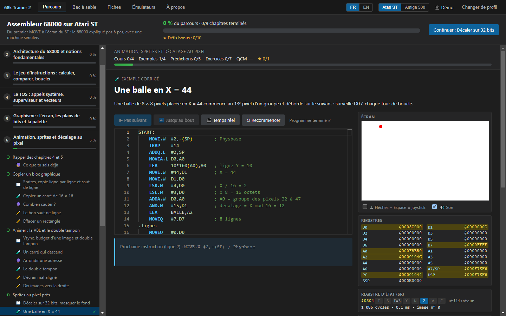

<p align="center"><a href="README.md">Version française</a></p>

<p align="center">
  
</p>

<h1 align="center">68k Trainer</h1>

<p align="center">
  Learn 68000 assembly by programming a simulated Atari ST or Amiga 500, step by step.
</p>

<p align="center">
  <a href="../../releases/latest"></a>
  <a href="../../releases"></a>
  
  <a href="LICENSE"></a>
</p>

<p align="center">
  <a href="../../releases/latest"><b>Download the latest version</b></a>
</p>

<p align="center">
  
</p>

<sub>The screenshots show the French interface; the whole software is also available in English.</sub>

## The idea

The 68000 is the processor of the Atari ST and the Amiga. 68k Trainer teaches it the way we used to
learn it in front of our machines, with Devpac or ASM-One, but with help we never had: every
instruction runs step by step, and you watch the registers, the memory and the screen change before
your eyes.

The first three chapters are about the 68000 itself and are shared by both machines. The course then
carries on with the Atari ST, in 9 chapters, or the Amiga, in 10 chapters. You can switch machines
whenever you like. To our knowledge, it is the first tool that brings the two together.

## The Amiga course

It starts with Exec and the libraries, then goes down to the hardware: the screen and the custom
chips, the Copper, the Blitter, sprites, Paula for sound, and finally a real AmigaDOS executable
that runs from the Shell or the Workbench. The simulated Amiga 500 (OCS, PAL) has the Copper, the
Blitter (copy, fill, lines), bitplanes, sprites, Paula, the CIAs, the mouse, the joystick and the
keyboard. Its simulated Kickstart 1.3 puts ExecBase at `$4` and reproduces the real jump tables of
exec, dos and graphics. Guru Meditation included.

<p align="center">
  
</p>

## The Atari ST course

It begins with TOS and its system calls, then moves on to the screen and the palette, animation and
double buffering, the keyboard, the joystick and sound, Devpac, and ends with Line-A and GEM. The
simulated 1040 STF has its low-resolution screen, its palette and rasters, the 50 Hz VBL, the MFP
68901, the IKBD keyboard, the YM2149 and a TOS (GEMDOS, BIOS, XBIOS) that knows how to drop its
bombs. Real-time mode runs at the speed of a real ST, with sound.

<p align="center">
  
</p>

## How a topic works

Each topic opens with a short lesson, followed by a worked example that you run line by line, with
an explanation of each one. Then comes a prediction question: what will this register hold, what is
going to happen? The exercises grow in difficulty, from a program to fill in to one you write on
your own, by way of programs to fix or to put back in order. A quiz closes the chapter, with bonus
challenges for those who want to go further.

These choices come from research in teaching: start from worked examples and withdraw the help
little by little, one difficulty at a time, read and predict before writing, and learn debugging as
a skill in its own right.

## The tools

- A debugger: step by step, breakpoints, disassembly, stack, memory and hardware registers.
- A 68000 assembler written for the software, Devpac-compatible and checked byte for byte against
  vasm, with its disassembler.
- Export to `.PRG` for Hatari or a real ST, and to an AmigaDOS executable for WinUAE, FS-UAE or a
  real Amiga.
- Emulators for study, installed on demand on Windows: Hatari with EmuTOS, WinUAE with the free
  AROS Kickstart. No copyrighted ROM is supplied, but you can use your own TOS or Kickstart. The
  "Try in the emulator" button runs the program on the real emulated machine.
- A sandbox that is a real editor (open, save, `INCLUDE` next to the source), and reference sheets:
  68000, TOS, MFP, Line-A and GEM, Amiga libraries and chips.
- Profiles, with progress, resuming where you left off, a progress report and a certificate as a
  PDF. A profile can be exported to move from one computer to another.

The software is available in French and English.

## Download

All the files are on the [latest release](../../releases/latest) page.

| System | File |
|---|---|
| Windows | the `Setup` installer, or the portable version, with no installation |
| Windows, full version | the same files with the `complet` suffix: Hatari, WinUAE and AROS are included and install without Internet |
| Linux | `.AppImage` or `.deb` |
| macOS (Intel and Apple Silicon) | `.dmg`; the package is not signed: the first time, right-click then Open |

The [user guide](docs/guide_utilisateur.md) (in French) explains how to get started.

**Code signing**: the Windows executables of the standard edition will be signed for free by
[SignPath.io](https://about.signpath.io), with a certificate by
[SignPath Foundation](https://signpath.org) (application in progress). See the
[Code signing policy](CODE_SIGNING_POLICY.md), which also contains the privacy policy: 68k Trainer
never sends any data.

## A mistake in a lesson?

The lessons and exercises are made to be improved. A wrong explanation, an impossible exercise or a
typo: [open an *issue*](../../issues/new/choose) with the template "Erreur dans un cours ou un
exercice" (error in a lesson or an exercise). Corrections by *pull request* are also welcome; the
content format is described in [content/parcours/README.md](content/parcours/README.md) (in French).

## Support the project

68k Trainer is free and open source. To support its development, new chapters or the emulators on
Linux and macOS, you can make a donation through PayPal:
[paypal.me/YMONTFORT](https://paypal.me/YMONTFORT). Thank you.

<details>
<summary><b>Developing</b></summary>

```bash
npm install
npm run dev        # starts the application in development mode
npm test           # tests: emulator, simulated TOS, and real execution of all the content
npm run typecheck
npm run dist:win   # Windows: installer + portable version (lightweight: emulators downloaded) in dist/
npm run dist:win:complet # Windows: the same with Hatari and WinUAE bundled (downloads the packages)
npm run dist:linux # Linux: AppImage + .deb (run it on Linux)
npm run dist:mac   # macOS: universal .dmg (run it on macOS)
```

> If the application does not open from a terminal started by an Electron-based tool, the
> `ELECTRON_RUN_AS_NODE` variable may be set: remove it before `npm run dev`.

| Folder | Contents |
|---|---|
| `src/cpu/` | 68000 emulator (`cpu.ts`, `exceptions.ts`, extension point `platform.ts`) |
| `src/platforms/atari-st/` | Atari ST: simulated TOS, VBL, MFP, IKBD, YM2149, screen, palette |
| `src/platforms/amiga/` | Amiga 500: custom chips, Copper, Blitter, sprites, Paula, CIA, simulated Kickstart |
| `src/asm/` | Devpac-compatible assembler, .PRG and AmigaDOS hunk formats, disassembler (no dependencies) |
| `src/shared/` | course model, progress calculation, exercise checking |
| `src/renderer/` | interface (TypeScript without a framework, Monaco editor) |
| `content/parcours/` | the `commun/` (shared), `atari/` and `amiga/` courses: one folder per chapter (`chapitre.json`, `.md` lessons, `code.s` sources) |
| `content/fichiers/` | files for INCLUDE and INCBIN (including `amiga-systeme.s`: taking over and handing back the system) |
| `content/courses/`, `content/exercises/` | reference sheets and exercises from version 0.1 |
| `docs/` | status report, source inventory, manual errata, emulator plan, reports (in French) |

Every example, solution and prediction is assembled and run by `tests/contenu-parcours.test.ts`:
wrong content makes the tests fail. The packages for the three systems are built by GitHub Actions
for every `vX.Y.Z` tag (`.github/workflows/release.yml`), and the tests run on Windows, Linux and
macOS.

The assembler and the disassembler (`src/asm/`, no dependencies) can also be used from the command
line:

```bash
npm run asm -- programme.s              # → programme.prg (TOS executable)
npm run asm -- programme.s --bin        # → flat binary
npm run desasm -- PROGRAMME.PRG -o p.s  # → Devpac source that reassembles identically
```

</details>

## Credits and licence

Developed by Yannick Montfort with Claude (Anthropic). The lessons were rewritten from Féroce
Lapin's 68000 assembly course on the Atari ST, David Bouchet's course (EPITA), Philippe Meyne's
course notes (IUT d'Évry) and the Motorola M68000PRM manual. The Amiga course was written from Amiga
Intern (Abacus), La Bible de l'Amiga, the Hardware Reference Manual and the AROS sources.

Free software under the GNU GPL v3 or later ([LICENSE](LICENSE)). Third-party components:
[THIRD_PARTY.md](THIRD_PARTY.md).
