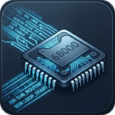
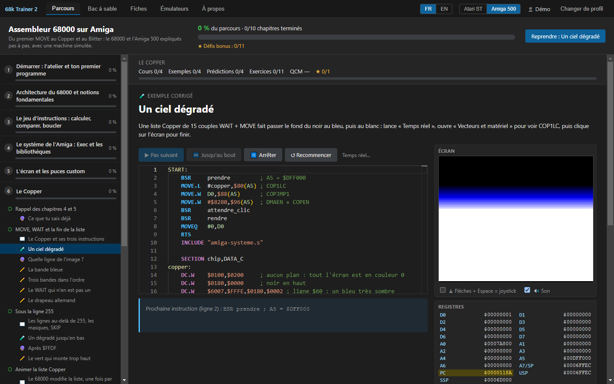
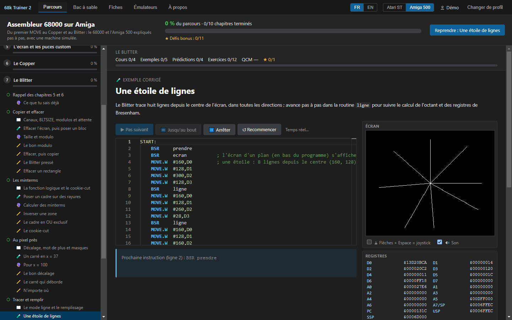
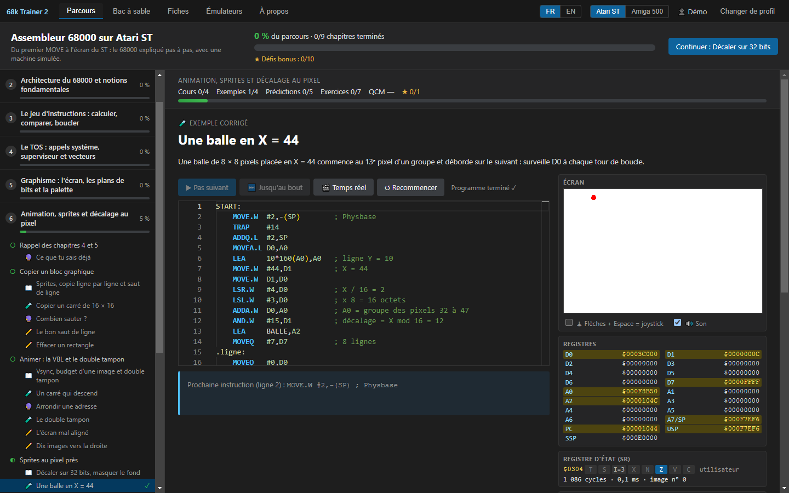

<p align="center"><a href="README.en.md">English version</a></p>

<p align="center">
  
</p>

<h1 align="center">68k Trainer</h1>

<p align="center">
  Apprendre l'assembleur 68000 en programmant un Atari ST ou un Amiga 500 simulés, pas à pas.
</p>

<p align="center">
  <a href="../../releases/latest"></a>
  <a href="../../releases"></a>
  
  <a href="LICENSE"></a>
</p>

<p align="center">
  <a href="../../releases/latest"><b>Télécharger la dernière version</b></a>
</p>

<p align="center">
  
</p>

## Le principe

Le 68000 est le processeur de l'Atari ST et de l'Amiga. 68k Trainer l'enseigne comme on l'apprenait
devant sa machine, avec Devpac ou ASM-One, mais avec une aide que nous n'avions pas : chaque
instruction s'exécute pas à pas, et l'on voit les registres, la mémoire et l'écran changer sous
ses yeux.

Les trois premiers chapitres portent sur le 68000 lui-même et sont communs aux deux machines. Le
parcours continue ensuite sur l'Atari ST, en 9 chapitres, ou sur l'Amiga, en 10 chapitres. On
change de machine quand on veut. À notre connaissance, c'est le premier outil qui réunit les deux.

## Le parcours Amiga

Il part d'Exec et des bibliothèques, puis descend vers le matériel : l'écran et les puces custom,
le Copper, le Blitter, les sprites, Paula pour le son, et pour finir un vrai exécutable AmigaDOS,
qui se lance depuis le Shell ou le Workbench. L'Amiga 500 simulé (OCS, PAL) comprend le Copper, le
Blitter (copie, remplissage, lignes), les plans de bits, les sprites, Paula, les CIA, la souris, le
joystick et le clavier. Son Kickstart 1.3 simulé place ExecBase en `$4` et reproduit les vraies
tables de sauts d'exec, de dos et de graphics. La Guru Meditation est fournie.

<p align="center">
  
</p>

## Le parcours Atari ST

Il commence par le TOS et ses appels système, puis passe à l'écran et à la palette, à l'animation
et au double tampon, au clavier, au joystick et au son, à Devpac, et se termine par la Ligne A et
le GEM. Le 1040 STF simulé a son écran en basse résolution, sa palette et ses rasters, la VBL à
50 Hz, le MFP 68901, le clavier IKBD, le YM2149 et un TOS (GEMDOS, BIOS, XBIOS) qui sait poser ses
bombes. Le mode temps réel tourne à la vitesse d'un vrai ST, avec le son.

<p align="center">
  
</p>

## Comment se déroule une notion

Chaque notion commence par un cours court, suivi d'un exemple corrigé que l'on exécute ligne par
ligne, avec l'explication de chacune. Vient ensuite une question de prédiction : que vaudra ce
registre, que va-t-il se passer ? Les exercices montent en difficulté, du programme à compléter à
celui que l'on écrit seul, en passant par le programme à corriger ou à remettre dans l'ordre. Un
QCM ferme le chapitre, avec des défis bonus pour ceux qui veulent aller plus loin.

Ces choix viennent de la recherche en didactique : partir d'exemples résolus puis retirer l'aide
peu à peu, une seule difficulté à la fois, lire et prédire avant d'écrire, et apprendre à
déboguer comme une compétence à part entière.

## Les outils

- Un débogueur : pas à pas, points d'arrêt, désassemblage, pile, mémoire et registres du matériel.
- Un assembleur 68000 écrit pour le logiciel, compatible Devpac et vérifié octet par octet contre
  vasm, avec son désassembleur.
- L'export en `.PRG` pour Hatari ou un vrai ST, et en exécutable AmigaDOS pour WinUAE, FS-UAE ou
  un vrai Amiga.
- Les émulateurs d'étude, installés à la demande sous Windows : Hatari avec EmuTOS, WinUAE avec le
  Kickstart libre d'AROS. Aucune ROM sous droits n'est fournie, mais on peut utiliser son propre
  TOS ou son Kickstart. Le bouton « Essayer dans l'émulateur » lance le programme dans la vraie
  machine émulée.
- Un bac à sable qui est un vrai éditeur (ouvrir, enregistrer, `INCLUDE` à côté du source), et des
  fiches de référence : 68000, TOS, MFP, Ligne A et GEM, bibliothèques et puces de l'Amiga.
- Des profils, avec la progression, la reprise là où l'on s'était arrêté, une attestation et un
  certificat en PDF. Un profil s'exporte pour passer d'un ordinateur à l'autre.

Le logiciel existe en français et en anglais.

## Télécharger

Tous les fichiers sont sur la page de la [dernière version](../../releases/latest).

| Système | Fichier |
|---|---|
| Windows | l'installeur `Setup`, ou la version portable, sans installation |
| Windows, version complète | les mêmes fichiers, suffixés `complet` : Hatari, WinUAE et AROS sont inclus et s'installent sans Internet |
| Linux | `.AppImage` ou `.deb` |
| macOS (Intel et Apple Silicon) | `.dmg` ; le paquet n'est pas signé : la première fois, clic droit puis Ouvrir |

Le [guide de l'utilisateur](docs/guide_utilisateur.md) explique la prise en main.

**Signature du code** : les exécutables Windows de la version standard seront signés gratuitement
par [SignPath.io](https://about.signpath.io), avec un certificat de la
[SignPath Foundation](https://signpath.org) (candidature en cours). Voir la
[Code signing policy](CODE_SIGNING_POLICY.md) (en anglais), qui contient aussi la politique de
confidentialité : 68k Trainer n'envoie aucune donnée.

## Une erreur dans un cours ?

Les cours et les exercices sont faits pour être améliorés. Une explication fausse, un exercice
impossible ou une faute : [ouvre une *issue*](../../issues/new/choose) avec le modèle « Erreur dans
un cours ou un exercice ». Les corrections par *pull request* sont aussi les bienvenues ; le format
du contenu est décrit dans [content/parcours/README.md](content/parcours/README.md).

## Soutenir le projet

68k Trainer est gratuit et libre. Pour encourager son développement, de nouveaux chapitres ou les
émulateurs sous Linux et macOS, tu peux faire un don par PayPal :
[paypal.me/YMONTFORT](https://paypal.me/YMONTFORT). Merci.

<details>
<summary><b>Développer</b></summary>

```bash
npm install
npm run dev        # lance l'application en mode développement
npm test           # tests : émulateur, TOS simulé, et exécution réelle de tout le contenu
npm run typecheck
npm run dist:win   # Windows : installeur + version portable (légers : émulateurs téléchargés) dans dist/
npm run dist:win:complet # Windows : les mêmes avec Hatari et WinUAE embarqués (télécharge les paquets)
npm run dist:linux # Linux : AppImage + .deb (à lancer sous Linux)
npm run dist:mac   # macOS : .dmg universel (à lancer sous macOS)
```

> Si l'application ne s'ouvre pas depuis un terminal lancé par un outil basé sur Electron, la
> variable `ELECTRON_RUN_AS_NODE` est peut-être définie : supprime-la avant `npm run dev`.

| Dossier | Contenu |
|---|---|
| `src/cpu/` | émulateur 68000 (`cpu.ts`, `exceptions.ts`, point d'extension `platform.ts`) |
| `src/platforms/atari-st/` | Atari ST : TOS simulé, VBL, MFP, IKBD, YM2149, écran, palette |
| `src/platforms/amiga/` | Amiga 500 : puces custom, Copper, Blitter, sprites, Paula, CIA, Kickstart simulé |
| `src/asm/` | assembleur compatible Devpac, formats .PRG et hunk AmigaDOS, désassembleur (sans dépendance) |
| `src/shared/` | modèle du parcours, calcul de la progression, vérification des exercices |
| `src/renderer/` | interface (TypeScript sans framework, éditeur Monaco) |
| `content/parcours/` | les parcours `commun/`, `atari/`, `amiga/` : un dossier par chapitre (`chapitre.json`, cours `.md`, codes `code.s`) |
| `content/fichiers/` | fichiers pour INCLUDE et INCBIN (dont `amiga-systeme.s` : prendre et rendre la main) |
| `content/courses/`, `content/exercises/` | fiches et exercices de la version 0.1 |
| `docs/` | état des lieux, inventaire des sources, errata du manuel, plan des émulateurs, rapports |

Chaque exemple, solution et prédiction est assemblé et exécuté par
`tests/contenu-parcours.test.ts` : un contenu faux fait échouer les tests. Les paquets des trois
systèmes sont construits par GitHub Actions à chaque tag `vX.Y.Z`
(`.github/workflows/release.yml`), et les tests tournent sous Windows, Linux et macOS.

L'assembleur et le désassembleur (`src/asm/`, sans dépendance) servent aussi en ligne de commande :

```bash
npm run asm -- programme.s              # → programme.prg (exécutable TOS)
npm run asm -- programme.s --bin        # → binaire à plat
npm run desasm -- PROGRAMME.PRG -o p.s  # → source Devpac réassemblable à l'identique
```

</details>

## Crédits et licence

Développé par Yannick Montfort avec Claude (Anthropic). Les cours sont reformulés à partir du cours
d'assembleur 68000 sur Atari ST du Féroce Lapin, du cours de David Bouchet (EPITA), du polycopié de
Philippe Meyne (IUT d'Évry) et du manuel Motorola M68000PRM. Le parcours Amiga est rédigé d'après
Amiga Intern (Abacus), La Bible de l'Amiga, le Hardware Reference Manual et les sources d'AROS.

Logiciel libre sous GNU GPL v3 ou ultérieure ([LICENSE](LICENSE)). Composants tiers :
[THIRD_PARTY.md](THIRD_PARTY.md).
